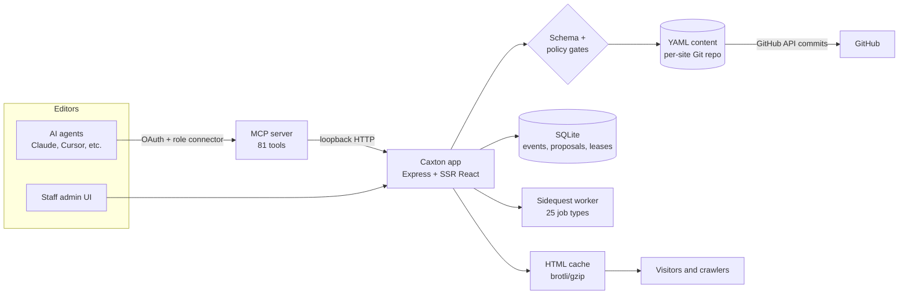

# Caxton: the agentic CMS

> A self-hosted, Git-backed CMS where AI agents run the website through the same validated pipeline as the human team. It runs [4geeks.com](https://4geeks.com).

**Years:** Nov 2025 to present · **Role:** sole architect, main contributor (79% of code) · **License:** MIT · **Repo:** [breatheco-de/caxton-cms](https://github.com/breatheco-de/caxton-cms)

Named after William Caxton, who brought the printing press to England. The idea is the same: own the press. Your pages live in your Git repo, your components are your code, and your agents edit the same YAML your team does.

## At a glance

| | |
|---|---|
| Content written by AI agents (with human review) | ~90% |
| Content shipped by agents with no human edit | ~30% |
| Hosting cost | $25/month, one VPS |
| Content entries on 4geeks.com | 883 |
| 4geeks.com traffic, 28 days (8 Oct to 4 Nov 2026) | 136,929 page views, 31,145 sessions, 17,953 users |
| Google Search, same 28 days | 1.66M impressions, 9,004 clicks |
| MCP tools exposed to agents | 81 |
| Capabilities / agent roles | 40 capabilities, 8 agent roles, 6 staff roles |
| Validators | 53, covering ~220 issue codes, with 12 auto-fixers |
| Test files | 717 (~6,000 test cases) |
| Commits in 12 months | 12,039 |

Sources and dates are listed under [Results](#results).

---

## The problem

4geeks.com ran on a free Vercel setup. It worked as a website, but there was no way to host AI agents next to it, and I wanted agents to do most of the content work: researching topics, writing and refreshing articles, fixing SEO issues, translating and checking the site.

The existing options all broke somewhere:

| Option | Where it breaks |
|---|---|
| Wix, Squarespace | No custom logic, limited SEO control, can't generate hundreds of pages, cost grows per feature |
| WordPress | A database server and a plugin ecosystem to maintain and secure |
| Contentful, Sanity | Content lives in someone else's cloud, pricing scales with your success |
| Next.js + MDX | Full control, but no editor: marketing files a GitHub issue to fix a typo |

None of them were built for the case I cared about: **AI agents as first-class editors**, where an agent can't do anything a human editor couldn't, every change is reviewable, and the system tells the agent what it did and didn't do.

So I built a CMS agent-first, AI-first.

---

## Architecture

Three ideas carry the design:

1. **Content is YAML in Git.** There is no content database. A page is a `meta` block plus a list of `sections`. Every write is validated and becomes a commit. Rollback is `git revert`.
2. **Pages are built from a typed component registry.** Each component ships a Zod schema, examples and field editors. One schema drives the editor UI, validation and the agent tooling.
3. **Humans and agents share one write path.** The admin UI and the MCP server go through the same validation. An agent cannot write a section a human couldn't have written.

### 1. Content model

- Each site has its own content folder, synced to its own GitHub repo.
- An entry is a folder: `_common.yml` for page-level fields (funnel, authors, publish date), one `{locale}.yml` per live language, and `{variant}.{locale}.yml` files for drafts and A/B variants.
- A **field-write router** sends every write to the right file based on a fixed field-scope map. In draft mode, even page-level fields stay in the draft until it's promoted.
- **Drafts come first.** New content and every agent edit land in a 0%-traffic variant. Going live is a separate, gated step.
- **Shared layouts.** A content type can use a template (`template.{locale}.yml`) that its entries inherit and override section by section. Every entry, whether it comes from YAML or a database row, merges the same way: template layers, then entry layer, then variables.
- **Section bindings.** The same section on many pages (a pricing block, a CTA) can be bound into a group. Editing one copies the content to all members through a background job. Section-level leases with fencing tokens stop two editors from overwriting each other.
- **Git without git.** Commits go through the GitHub REST tree/commit API, not the git CLI. A debounced queue batches writes. Each staff member commits under their own GitHub token, so the history shows who changed what. Sync state is tracked with file hashes and saved to cloud storage so it survives deploys.
- **Deploy-safe.** Before a deploy replaces content folders with a fresh pull, unsynced content is pushed first, and writes are briefly paused during the switch. Public lead forms are never paused.

### 2. Component registry

- Each component has a Zod schema (one union per variant), a `schema.yml` with usage notes for humans and agents, field-editor hints, and example YAML.
- A sync script regenerates `schema.yml` from the Zod schema and keeps the hand-written docs, so the two can't drift.
- **Design rules are code, not guidelines:**
  - Section components can't set their own outer vertical spacing. The section wrapper owns it, and a pre-commit check enforces it.
  - Colors must be theme palette IDs. An agent write that introduces a raw hex color is rejected; a staff write only gets a warning.
- Component screenshots are captured in the browser and marked stale when the component changes, so agents can "see" components before using them.

### 3. Rendering, multi-site and SEO

- Server-side rendered React (Vite) with streaming. The client hydrates only the above-the-fold sections first.
- **HTML cache:** an in-memory LRU of public pages, stored already compressed. It's refreshed by invalidation and background rebuilds, not timers. Each A/B variant gets its own cache key. AI crawlers get a version of the page built for LLMs.
- **Multi-site:** one deployment serves several domains (4geeks.com, 4Geeks Florida, business.4geeks.com). A child site can inherit the component registry and theme of a parent.
- **i18n:** per-locale URL patterns and slugs, hreflang, and locale-aware sitemaps.
- **SEO:** sitemaps, schema.org (the same code runs at render time and in background jobs, so stored HTML always matches), IndexNow, and Search Console data through BigQuery.
- **Redirect manager with conflict detection:** it catches duplicate sources, a pattern rule that shadows another, and a redirect that would hide a live page, and suggests a fix for each.

### 4. The agent interface (MCP)

This is the core of the system. Agents connect over the Model Context Protocol and get **81 typed tools**: reading entries, editing fields, adding sections, translating, running diagnostics, managing redirects, reading analytics and more.

**Permissions**

- **40 capabilities**, many scoped to specific content types or databases.
- **Role-scoped connectors.** Each agent connects to `/mcp/role/<role>` and sees only that role's tools. There are 8 agent roles: orchestrator, copy editor, SEO specialist, layout editor, translator, media editor, proposal reviewer and publisher. They are defined in code and re-seeded on every boot.
- **Per-user switches.** MCP read is on by default and write is off by default. With write off, an agent can still propose changes but can't apply them.
- **OAuth** with dynamic client registration and protected-resource metadata, so agents connect from Claude.ai as a standard custom connector.
- **Agent identity.** Every write needs an agent session that records the exact model string, and every change is tied to that session.

**The response envelope**

Every write returns the same structure:

| Field | Purpose |
|---|---|
| `warnings` | What did **not** happen (e.g. "this did not update the Spanish version") |
| `side_effects` | What else changed (e.g. 12 bound sections updated) |
| `next_actions` | The exact tools to call next, marked required, recommended or optional |

Risky actions return an **action-required gate** instead of an error, such as `confirm_live_edit` or `confirm_affected_entries`, so the agent has to stop and confirm. Tools that can't finish quickly (diagnostics) return a job ID to poll instead of blocking.

The main lesson: **agents fail silently on what they assume happened.** Telling them explicitly what didn't happen removed a whole class of errors. I wrote these rules up as 7 public standards for MCP servers.

**Playbooks**

- `explain_site` serves 30 short topics (proposals, SEO, routing, layouts, funnels).
- `bootstrap_agent` gives each new agent the conventions document, versioned so agents re-read it when it changes, plus the last 6 days of a changelog of agent-facing changes (245 entries so far).

### 5. Proposals: how agents and humans share the work

Agents don't publish freely. They work through a proposal system (36 source files):

- **Three kinds of proposal:** `idea` (a new page or refresh), `edits` (changes already written into a draft) and `notes` (handoffs).
- **The draft is the source of truth.** An edit proposal writes its changes into a 0%-traffic draft right away and records a fingerprint of the live page. Applying it promotes the draft after checking the fingerprint:
  - If the live page changed but in other fields, the draft is rebuilt on top of it.
  - If the same fields changed, the proposal goes back to its author.
- **Four-eyes review.** The approver can't be the same person and role as the author. Approval is also refused from the same agent session, from the same model under a different role (by default), and from anyone who edited the draft outside the proposal. This stops one model from approving its own work by switching hats.
- **Blockers instead of rejections.** Reviewers add blockers the author can fix. Since Nov 2026, only staff can override a blocker, with a logged reason.
- **Ideas carry their intent.** Before an idea is accepted it must name its funnel stage and products, and its target keyword and cluster. Accept refuses a keyword that another live page or accepted idea already owns, which prevents cannibalization by design.
- **Evidence checks.** Local rules flag outcome figures (hiring rate, salary, tuition). Ambiguous cases go to a small decision model with a timeout and a safe fallback. Third-party claims (partners, press, awards) are matched against an evidence database, and every source link is archived on archive.org.
- **Maintenance runs on its own.** Idle proposals are flagged at 10 days and withdrawn at 30. Orphaned drafts are cleaned up.

This is what makes the 90% / 30% split possible: agents do most of the work, and the gates decide which parts need a human.

### 6. Diagnostics and validation

- **53 validators** covering meta, redirects, slug conflicts, sitemaps, SEO clusters and intent, schema.org, forms, funnel completeness, layout, draft integrity, external links and text limits. About 220 issue codes and **12 auto-fixers**.
- Diagnostics run in a forked worker, so a full-site scan never slows down the public site.
- Agents get results through async jobs with freshness control. A scan of one page says which cross-page checks it skipped, so an agent never reads a partial scan as "all clear".
- Issues can be claimed, completed and reopened, so agents can work through a shared queue.
- **Runtime issues:** 404s are collected per site and replayed through the redirect map.
- **Render review:** pages are screenshotted at several viewport sizes and checked against layout rules.

### 7. Jobs, events and storage

- **Background jobs:** 25 job types on Sidequest with an SQLite backend: index refresh, validation on save, binding propagation, HTML rebuilds, SEO index, ad sync, vector index, evidence archiving, IndexNow and proposal maintenance.
- **Events:** 72 event types in an outbox table, dispatched to jobs and to outgoing webhooks.
- **SQLite, no database server.** A per-site database holds events, leases, proposals, the lead ledger and the URL change log, with 46 hand-versioned migrations and a backup on every boot.
- **Search:** Qdrant with local embeddings, so no external search API.

### 8. Growth features

The CMS also covers the marketing loop, not just publishing:

- **First-party analytics** with no cookie, IP or visitor ID.
- **Ads:** Google Ads and Meta data, paid landing page detection, UTM checks.
- **Leads:** the lead is saved encrypted before the CRM call, so a CRM outage doesn't lose leads; failed calls are retried. Every lead form must have a consent checkbox before it can be published.
- **A/B testing:** cookie-based variant assignment and a chi-square check that the real split matches the configured one.
- **Products and funnels:** pages are tagged by funnel stage and product, and leads are attributed by product and persona.

### 9. Deploy and operations

- One DigitalOcean VPS, $25/month. Nginx in front; pm2 under systemd runs four processes: the web app, the MCP server, the job worker and Qdrant.
- Releases are atomic: a `current` symlink points to the active release.
- A CLI creates a new site in an empty folder, or connects a local agent (Cursor, Claude Code). For cloud agents it opens a Cloudflare tunnel and points OAuth at the tunnel's address.
- **Rate limits in code:** every new API route has to declare a rate policy (for example, expensive AI calls are capped per person and globally).

### 10. Built for coding agents too

The codebase is set up so coding agents can work on it safely:

- `AGENTS.md` as the entry point, 20 rule files, 6 skills (for example, building a new component from a picture), and a folder of notes on known pitfalls.
- Hard rules enforced by checks, not by asking the model to remember them: pre-commit spacing check, pre-push type check of the MCP server plus the full test suite, and registry and schema checks before every build.
- 717 test files.

---

## Key decisions

| Decision | Alternative rejected | Why |
|---|---|---|
| YAML in Git, no content database | Postgres or a headless CMS | Every change is a diff, rollback is free, the site owner owns everything, and hosting stays at $25 |
| One schema per component drives UI, validation and agent tools | Separate editor config and API docs | Define once, so humans and agents always see the same contract |
| Agents and humans share one write path | A separate "AI API" | An agent can never do what a human editor couldn't |
| Rules in code, not in prompts | Long system prompts telling agents what not to do | Gates (four-eyes, theme IDs, spacing, funnel intent) hold no matter which model connects |
| Drafts first, promote by fingerprint | Agents editing live pages | Every agent change is reviewable and safe to apply even if the live page moved |
| Response envelope with `warnings` and `next_actions` | Plain success and error responses | Agents act on what they believe happened; tell them explicitly |
| Role-scoped connectors | One connector with every tool | Smaller tool lists make agents more accurate, and each role can only do its job |
| SQLite and a local job queue | Redis, a queue service, managed Postgres | One VPS, nothing else to operate |
| GitHub API for commits | Git CLI on the server | No working-tree state to corrupt; works the same after every deploy |

---

## Results

| Metric | Value | Source |
|---|---|---|
| Content entries on 4geeks.com | 883 (384 blog posts, 102 how-tos, 83 landing pages, 76 interactive exercises, 72 locations, 24 programs) | Caxton MCP `list_entries`, 6 Nov 2026 |
| Traffic, 8 Oct to 4 Nov 2026 | 136,929 page views, 31,145 sessions, 17,953 users | GA4 BigQuery export via Caxton MCP, 6 Nov 2026 |
| Google Search, same window | 1,662,874 impressions, 9,004 clicks | Search Console via Caxton MCP, 6 Nov 2026 |
| Share of content by agents | ~90% with human review, ~30% fully autonomous | Author's estimate, Nov 2026 |
| Hosting | $25/month (before: free Vercel tier, which couldn't host agents) | Author, Nov 2026 |
| Codebase | ~609k lines of TypeScript (excluding tests), 717 test files | Repo, 6 Nov 2026 |
| Commits | 12,039, 14 Nov 2025 to 5 Nov 2026 (site content now lives in separate per-site repos and is not counted) | Git history, 6 Nov 2026 |

---

## Timeline

| When | Milestone |
|---|---|
| Nov 2025 | First commit. Component registry with Zod schemas |
| Dec 2025 | Validation framework |
| Jan 2026 | GitHub sync without the git CLI |
| Feb 2026 | Cloud media storage, auto-commit queue, hreflang. Peak month: 3,823 commits |
| Mar 2026 | AI chat layer, image optimization pipeline |
| May 2026 | **MCP server** and OAuth for the Claude.ai connector. RBAC, capabilities, versioning, products, vector search |
| Jun 2026 | Multi-site: one content repo per site |
| Jul 2026 | HTML page cache, MCP response envelope, shared-layout sync |
| Aug 2026 | Event outbox, pipeline database, background job worker, agent changelog, rate-limit policies |
| Sep 2026 | **Proposals system and agent roles**, CLI, agent write gate, role connectors, decision model for evidence checks |
| Oct 2026 | Proposals 1.0 (draft as source of truth), first-party analytics, lead outbox, evidence archive |
| Nov 2026 | IndexNow, staff-only blocker overrides |

---

## My role

I am the sole architect of Caxton and its main contributor.

Every technical and architectural decision was mine: storage formats, libraries, the queue strategy, the caching strategy, performance optimization, logging and observability, and the MCP server architecture.

The code was written with AI assistance, fully supervised: I directed it and read every change myself. That is the same model Caxton applies to content: AI does the volume, and a human owns the decisions and the review.

| Contributor | Code lines added | Share | Lines in today's codebase | Share |
|---|---|---|---|---|
| **Alejandro Sánchez (me)** | 784,660 | **79%** | 623,243 | **85%** |
| [Alejandro Jiménez Morales](https://www.linkedin.com/in/alejandro-jimenez-morales/) | 149,564 | 15% | 76,659 | 10.5% |
| Replit Agent | 29,931 | 3% | 17,302 | 2.4% |
| Luis Miguel Del Valle | 13,427 | 1% | 6,308 | 0.9% |
| Omar Hidalgo | 14,401 | 1% | 4,738 | 0.6% |

How these were measured (6 Nov 2026): code files only (`.ts`, `.tsx`, `.js`, `.css`, `.sh`), each person's accounts merged, excluding site content, lockfiles, data dumps and model files. "Lines in today's codebase" is `git blame` over all 2,680 code files (~732k lines). By commit count the split is closer (about 5,500 commits for me, 4,100 for Alejandro Jiménez, of 12,039), because many of my commits are large.

## Evidence

- Source code: [github.com/breatheco-de/caxton-cms](https://github.com/breatheco-de/caxton-cms)
- Live: [4geeks.com](https://4geeks.com)
- MCP tool reference: [`mcp-server/README.md`](https://github.com/breatheco-de/caxton-cms/blob/main/mcp-server/README.md)
- MCP response standards: [`docs/blog/mcp-standards.md`](https://github.com/breatheco-de/caxton-cms/blob/main/docs/blog/mcp-standards.md)
- Article: [MCP has no quality standards, so we wrote ours](https://github.com/breatheco-de/caxton-cms/blob/main/docs/blog/mcp-has-no-quality-standards-we-wrote-ours-so-agents-can-run-our-website.md)
