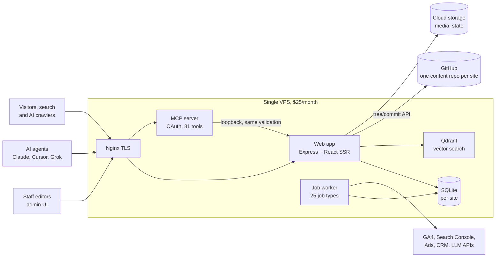

# Caxton: technical architecture and engineering achievements

[Overview](README.md) · **Technical** · [Product](PRODUCT.md)

> An agent-native content platform: Git as the system of record, a schema-first component model, and a governed MCP control plane that lets AI agents operate a production website under least-privilege access, separation of duties and optimistic concurrency control. It runs on a single $25/month VPS.

## Metrics at a glance

| Metric | Value |
|---|---|
| Agent interface | 81 MCP tools, 40 capabilities, 8 agent roles, 6 staff roles |
| Governed agent throughput | 1,457 proposals filed in 8 weeks, 1,022 applied, 4.8% rejection rate |
| Quality gates | 53 validators, ~220 issue codes, 12 auto-fixers, 31 review rules |
| On-page SEO score | 97.3 / 100, 0 high-severity issues (20-page sample, 19 templates) |
| Infrastructure | 1 VPS, 4 supervised processes, $25/month, no managed services |
| Test coverage | 717 test files, ~6,000 test cases |

All values are measured as of 9 to 10 Nov 2026 unless marked otherwise. See [Results](#results) for sources.

---

## 1. System context

## 2. Requirements and constraints

The architecture was designed against these requirements:

| Requirement | Target |
|---|---|
| Agent safety | An agent must never be able to do what a human editor could not, and every agent change must be reviewable and reversible |
| Operating cost | Fit a single small VPS; no managed database, cache, queue or search service |
| Operability | Operable by one engineer; deploys must not lose content or block lead capture |
| Ownership | Content and code fully owned by the site operator, portable with no vendor lock-in |
| Multi-tenancy | Several domains from one deployment, each with its own content repository |
| Search performance | Server-rendered HTML for search engines and AI crawlers; multilingual (EN/ES) |

## 3. Architecture overview

Caxton is organized in five layers:

1. **Content layer.** YAML files in a per-site Git repository, with a layered merge model (template, entry, locale, variant).
2. **Schema layer.** A versioned component registry; each component's Zod schema is the single contract for the editor UI, write validation and agent tooling.
3. **Write path.** One validated pipeline shared by the admin UI and the MCP server, with policy gates (four-eyes, theme, funnel, evidence) enforced server-side.
4. **Delivery layer.** Streaming SSR with an event-invalidated, pre-compressed HTML cache, multi-site routing, i18n and SEO generation.
5. **Async layer.** A transactional outbox feeding a SQLite-backed job queue for propagation, rebuilds, validation, syncs and maintenance.

## 4. Architecture Decision Records

### ADR-01: Git as the system of record for content

- **Context.** Agents would generate hundreds of changes per week. Every change had to be attributable, reviewable and reversible, at minimal operating cost.
- **Decision.** Store all content as YAML in a per-site Git repository. No content database. Commits go through the GitHub REST tree/commit API from a debounced, batched commit queue, with per-author attribution (each staff member commits under their own GitHub token).
- **Alternatives considered.** Postgres-backed headless CMS; hosted CMS (Contentful, Sanity); git CLI on the server.
- **Consequences.** Full audit trail and point-in-time restore for free (`git revert`, file- or folder-level restore). Zero database operations. The API-based commit path avoids working-tree corruption across deploys. Trade-off: querying content requires an in-memory index (see ADR-07), and Git sync state must be tracked explicitly (file-hash ledger persisted to cloud storage).

### ADR-02: Schema-first component registry as the single contract

- **Context.** Humans and agents both build pages from components. Divergent contracts between the editor, the API and the agent docs would cause silent breakage.
- **Decision.** Every component ships a versioned Zod schema (a discriminated union per variant), example content, field-editor hints and usage guidance. A sync tool regenerates the agent-facing `schema.yml` from the Zod source and fails CI on drift.
- **Alternatives considered.** Separate editor configuration and API documentation; free-form rich text.
- **Consequences.** One definition drives the UI, validation and the MCP tools. Design-system rules (theme palette IDs only, wrapper-owned section spacing) are enforced as code: pre-commit checks for engineers, write-time rejections for agents.

### ADR-03: A single write path for humans and agents

- **Context.** A separate "AI API" would drift from the editor and create a second, weaker security boundary.
- **Decision.** The MCP server calls the main application over loopback HTTP, through exactly the same validation and policy gates as the admin UI. A field-write router assigns every field to its storage layer from a fixed field-scope map.
- **Consequences.** By construction, an agent cannot write content a human editor could not. Policy is implemented once. Defense in depth: capability checks run at catalog time (tool visibility), call time (handler checks) and write time (application gates).

### ADR-04: MCP control plane with least-privilege, role-scoped connectors

- **Context.** Large tool catalogs reduce agent accuracy, and broad credentials make one misbehaving agent dangerous.
- **Decision.** Expose agents through MCP with a capability-based RBAC model: 40 capabilities (many scoped to content types or databases), 8 code-defined agent roles and 6 staff roles. Each agent connects to `/mcp/role/<role>` and sees only that role's tools. OAuth 2.1 with dynamic client registration and RFC 9728 protected-resource metadata; per-user MCP read/write switches (write off by default); every write bound to an agent session that records the exact model identifier.
- **Alternatives considered.** One connector with the full catalog; static API keys.
- **Consequences.** Least privilege by default, a full agent audit trail, and standard connectivity from Claude.ai, Cursor and other MCP clients. Agent roles are re-seeded from code on every boot, so permissions cannot drift through the UI.

### ADR-05: An explicit response contract for agents

- **Context.** In early operation, the dominant agent failure mode was acting on assumptions about what a write had done (for example, assuming a Spanish page was updated along with the English one).
- **Decision.** Every mutating tool returns a fixed envelope: `warnings` (what did **not** happen), `side_effects` (blast radius) and `next_actions` (exact next tools, ranked required, recommended or optional). Risky operations return non-error **action-required gates** (`confirm_live_edit`, `confirm_affected_entries`) that force the agent to stop and confirm. Long operations return a job ID to poll instead of blocking.
- **Consequences.** Removed a whole class of silent agent errors. The contract is documented as 7 public MCP standards and 16 internal response rules, and agent-facing changes are logged in a versioned changelog (245 entries) that agents re-read on connect.

### ADR-06: Draft-backed proposals with optimistic concurrency control and separation of duties

- **Context.** Agents and humans edit the same pages concurrently. Reviews take time, and live content moves underneath a pending change.
- **Decision.** Every agent edit is materialized immediately into a 0%-traffic draft variant and recorded with a fingerprint of the live baseline. Apply promotes the draft only after an optimistic-concurrency check: non-overlapping live changes trigger an automatic rebase; overlapping changes return the proposal to its author (`context_stale`). Separation of duties is enforced in code: the approver cannot be the same user and role, the same agent session, the same model under another role (by default), or a co-author of the draft.
- **Alternatives considered.** Agents editing live pages directly; pessimistic locking of pages during review.
- **Consequences.** 1,022 proposals applied in 8 weeks with no lost updates by design. Section-level concurrent edits are additionally protected by distributed leases with fencing tokens (compare-and-set with TTL).

### ADR-07: Embedded SQLite, a transactional outbox and a local job queue

- **Context.** The cost ceiling ruled out managed Postgres, Redis and queue services.
- **Decision.** Per-site SQLite databases (46 versioned migrations, backup on every boot) for events, leases, proposals and the lead ledger. Domain events (72 types) are written to an outbox table and dispatched to a SQLite-backed job queue (Sidequest, 25 job types) with deduplicated enqueue keys. Content queries are served from an in-memory content index with incremental, folder-scoped refresh.
- **Consequences.** Zero external infrastructure, reliable at-least-once processing, and no lost side effects when a request fails mid-flight. Trade-off: single-node architecture (see [Trade-offs](#9-trade-offs-and-technical-debt)).

### ADR-08: Event-driven HTML caching with pre-compression

- **Context.** Server-side rendering every request on one VPS would not scale to crawler and AI-bot traffic.
- **Decision.** An in-memory LRU of anonymous public HTML, stored pre-compressed (Brotli and gzip), keyed by build, site, path and A/B variant. Freshness is maintained by event-driven invalidation and background rebuilds, never by TTL. AI crawlers receive an LLM-optimized rendition.
- **Consequences.** Cached pages are served without rendering or compression cost, and A/B variants never leak across cache keys.

### ADR-09: In-process observability instead of a SaaS APM

- **Context.** Production debugging was needed for four processes without adding paid monitoring services.
- **Decision.** Structured logging with pino, with warnings and errors persisted to a queryable SQLite error log. Per-process statistics in 30-second windows (event-loop stall detection, API and page timings). Host-level CPU stack sampling captured by a systemd service with 7-day retention. Job-worker heartbeats with stuck-job detection. A public 404 store with redirect replay. Agent session tracing on every write.
- **Consequences.** Full operational visibility inside the $25 budget. Trade-off: no distributed tracing across external services.

## 5. Scalability and performance

- **Rendering.** Streaming SSR (`renderToPipeableStream`); the client hydrates above-the-fold section chunks first.
- **Caching.** Pre-compressed HTML LRU with event-driven invalidation (ADR-08).
- **Indexing.** In-memory content index per site, refreshed incrementally per changed folder; full rebuilds offloaded to the job queue.
- **Isolation.** Diagnostics run in a forked worker so full-site scans never block public traffic. Validation, rebuilds and propagation run in the job worker.
- **Media.** Images re-encoded to WebP/AVIF with `srcset`; local or cloud storage.
- **Measured result.** 97.3 / 100 on-page SEO score with full server-rendered HTML on every sampled template (OpenRush crawl, 20 pages, 10 Nov 2026).

## 6. Reliability

- **Deploy safety.** Before a release replaces content folders, unsynced content is flushed to GitHub, and staff and agent writes are paused during the switch. Lead capture is never paused.
- **Atomic releases.** A `current` symlink switches between immutable release directories.
- **Lead durability.** Leads are written encrypted to a local outbox before the CRM call; failures retry with backoff, and client errors route to a needs-attention queue.
- **Process supervision.** pm2 under systemd, memory-based restarts, an in-process heap watchdog at 85%.
- **Data safety.** YAML placeholder escaping prevents a parse/serialize round trip from corrupting templated content.
- **Self-maintenance.** Daily sweeps flag idle proposals at 10 days and close them at 30; orphaned drafts are unlinked after 7 days.

## 7. Security and access control

- Capability-based RBAC with least-privilege role connectors (ADR-04).
- OAuth 2.1 for agents, with encrypted token persistence.
- Separation of duties on every approval (ADR-06); blocker overrides restricted to staff with a logged reason.
- Agent-specific write gate: drafts are free, live writes require an active claim on a matching issue, and publish/create go through proposals only.
- Policy-as-code on API traffic: every new route must declare a rate-limit policy (for example, expensive AI calls capped per user and globally).
- Consent gate: lead forms cannot be published without a mandatory consent control. First-party analytics store no cookie, IP or visitor ID.

## 8. Quality engineering

- **717 test files** (~6,000 test cases) on Vitest, plus a stress-test harness.
- **53 validators** with ~220 issue codes and **12 auto-fixers**, run on save and on demand as async jobs.
- **Content claims verification.** Outcome figures (hiring rate, salary, tuition) are detected by rules plus a small decision model with a 2-second timeout and a safe fallback; third-party claims are matched against an evidence database, and each source is archived.
- **Guardrails as code.** Pre-commit section-spacing check; pre-push MCP type check and full test suite; registry, schema and site-config checks before every build.
- **Agent-ready repository.** `AGENTS.md`, 20 rule files and 6 skills let coding agents work on the codebase under the same rules-in-code discipline.

## 9. Trade-offs and technical debt

| Item | Trade-off accepted | Mitigation or plan |
|---|---|---|
| Single-node SQLite | No horizontal scaling of the write path | Read traffic served from pre-compressed cache; vertical headroom on the VPS |
| Proposals service size | One 10,500-line service module | Candidate for decomposition by lifecycle stage |
| Authentication | Migration to Clerk still in progress; legacy auth on some routes | Pluggable auth layer already in place |
| Naming | Package renamed to `caxton`, CLI binary still `weblify` | Finish the rename before public launch |
| Observability | No distributed tracing across external APIs | In-process logs, process stats and CPU sampling cover the core |

## 10. Lessons learned

1. **Tell agents what did not happen.** Explicit `warnings` and `next_actions` removed more agent errors than prompt tuning.
2. **Rules belong in code, not in prompts.** Gates enforced server-side hold regardless of which model connects; instructions in prompts do not.
3. **Separation of duties must account for models, not just users.** One model can approve its own work by switching roles unless the system checks for it.
4. **Draft-first beats lock-first.** Optimistic concurrency with automatic rebase kept throughput high while live pages kept changing.

## Results

| Metric | Value | Type | Source (as of) |
|---|---|---|---|
| Lines of TypeScript in the current codebase | ~732k across 2,680 files | Measured | `git blame`, caxton-cms repo (6 Nov 2026) |
| Test files | 717 (~6,000 test cases) | Measured | Repo scan (6 Nov 2026) |
| MCP tools / capabilities / roles | 81 / 40 / 8 agent + 6 staff | Measured | Repo scan (6 Nov 2026) |
| Validators / issue codes / fixers | 53 / ~220 / 12 | Measured | Repo scan (6 Nov 2026) |
| Job types / event types / migrations | 25 / 72 / 46 | Measured | Repo scan (6 Nov 2026) |
| Proposals filed | 1,457 (16 Sep to 9 Nov 2026) | Measured | Caxton proposals log (10 Nov 2026) |
| Share authored by AI agents | 100% of 1,434 closed proposals (0 from the staff UI) | Measured | Caxton proposals log, filtered by actor type (10 Nov 2026) |
| Proposals applied | 1,022 (699 edits, 310 ideas, 13 notes) | Measured | Caxton proposals log (10 Nov 2026) |
| Rejection rate | 4.8% (51 of 1,073 decided) | Derived | Caxton proposals log (10 Nov 2026) |
| On-page SEO score | 97.3 / 100, 0 high-severity issues | Measured | OpenRush site audit, 20 of 819 sitemap URLs (10 Nov 2026) |
| Hosting cost | $25/month | Measured | Author (Nov 2026) |
